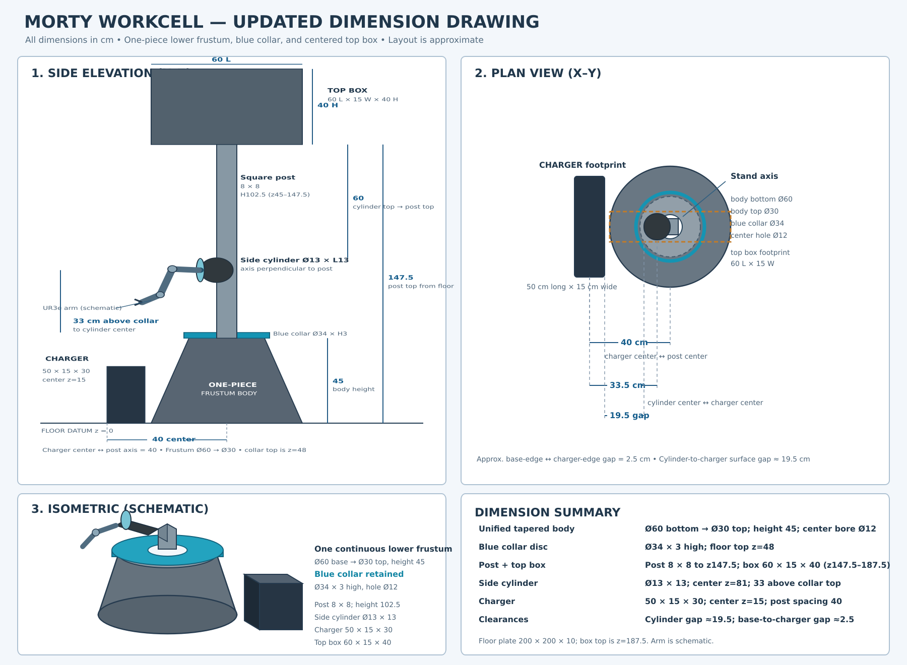

# Morty UR3e ROS 2 Project

A clean project bundle for the Morty UR3e workcell: URDF/Xacro and mesh assets, MoveIt configuration, a mock ros2_control setup, a collision-checked joint motion node, and a replayable synthetic OpenPI-shaped action sample.



Browse the source and drawings in this repository, or use **Code > Download ZIP** to download the complete project and extract it before running the ROS demo locally. RViz and ROS nodes run on your computer.

## Run on Ubuntu 24.04 with ROS 2 Jazzy

Install the required packages if needed:

```bash
sudo apt update
sudo apt install ros-jazzy-moveit ros-jazzy-ros2-control ros-jazzy-ros2-controllers ros-jazzy-ur-description ros-jazzy-xacro ros-jazzy-joint-state-publisher-gui python3-tk python3-colcon-common-extensions
```

From the extracted project folder, build and run the mock demo:

```bash
source /opt/ros/jazzy/setup.bash
colcon build --symlink-install --base-paths src --packages-select ur3e_learning_description ur3e_safe_motion
source install/setup.bash
ros2 launch ur3e_safe_motion openpi_safe_demo.launch.py
```

The demo publishes the sample at `src/ur3e_safe_motion/config/synthetic_openpi_pi05_droid_motion_check.json` to `/openpi/action`. The receiver validates the 15 x 7 chunk, maps the first six channels to UR3e joint positions in radians, and asks MoveIt to plan and execute the first target. The seventh channel is a normalized gripper target; it is validated but not executed. Later chunk rows are validated but not streamed.

For RViz and manual joint sliders together, stop the synthetic demo first and run:

```bash
ros2 launch ur3e_safe_motion safe_motion.launch.py launch_rviz:=true launch_slider:=true
```

The synthetic demo disables the sliders. Run only one workcell launch at a time.

To replay the demo, stop the launch with Ctrl+C and run the launch command again. To stop ROS cleanly, use Ctrl+C and wait for the launch to exit.

## Project contents

- `src/ur3e_learning_description`: robot/workcell URDF and Xacro, meshes, launch and visualization resources.
- `src/ur3e_safe_motion`: MoveIt setup, safe motion node, synthetic publisher/receiver, JSON sample, and package instructions.
- `docs/reports`: project report in Markdown, DOCX, and PDF.
- `docs/dimensions`: latest V3 dimension drawing and its source render scripts.

## Scope

This is a mock-hardware visualization and software integration demo. It does not command a physical UR3e, and it does not run live OpenPI inference. The URDF and MoveIt collision model only account for geometry included in the project.

The bundled reports describe an earlier demo revision and may mention a 15 x 8 sample. The current source and JSON samples use the custom Morty 15 x 7 interface described above.
